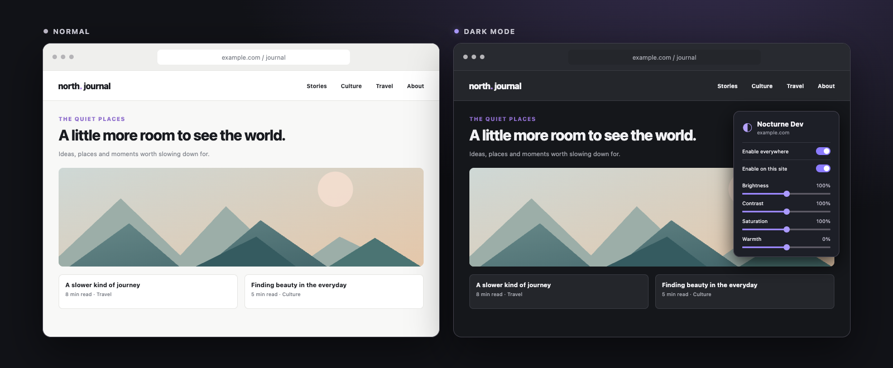

# Nocturne Dev

A local Manifest V3 Chrome extension that applies a configurable dark appearance to HTTP(S) websites.

*Illustrative mock-up; results vary by website.*

## Install locally

1. Open `chrome://extensions`.
2. Enable **Developer mode**.
3. Choose **Load unpacked**.
4. Select this `nocturne-dev` folder.

The extension has no account, telemetry, payment, or extension-operated remote service. It cannot run on Chrome's own internal pages, the Web Store, or other protected pages.

## Privacy and permissions

The extension needs access to HTTP(S) pages and their frames to inspect computed styles and apply a dark theme. This broad access also means the extension has the technical ability to access content on those pages. The current code does not collect form contents, logins or browsing history, or send page data to an extension-operated server.

Appearance preferences, the global switch, and the hostnames you explicitly enable or disable are saved in `chrome.storage.sync`. Chrome may sync these settings to your signed-in Chrome profile depending on your sync configuration. Computed page colours are kept only in memory for the active document.

- `storage`: save settings and site exceptions.
- `tabs`: identify open pages when applying settings.
- `scripting`: apply or remove the theme on pages.
- `<all_urls>`: allow the theme on supported websites and their frames.

## Included behavior

- globally enabled/disabled switch
- domain-level allow/deny override, including enabling a site when the global default is off
- protection for image, video, canvas and iframe pixels
- brightness, contrast, saturation, and warmth adjustments
- applies on normal page navigations

## Colour decision rules

Nocturne Dev uses the browser's computed CSS values rather than a list of website-specific selectors. Its rules are intentionally conservative:

1. **Classify the paint.** Solid colours, gradients and `::before`/`::after` UI surfaces are candidates, including those in open Web Component Shadow DOMs. Image URLs, media elements, canvases and iframes are never colour-filtered. Translucent gradient overlays associated with media are preserved, so they cannot become opaque covers over thumbnails.
2. **Transform surfaces by luminance.** Only light surfaces are mapped to the dark palette. A surface that was already dark stays dark, preventing black text from being introduced on existing dark cards.
3. **Choose text from the resulting background.** Foreground colour is derived from the effective (including inherited) background, not merely inverted from the source colour. Text over images or positioned captions receives a light colour and shadow.
4. **Treat vectors as interface foreground.** Near-black inline SVG paint becomes light; coloured vector marks are preserved.
5. **Support modern CSS colours.** RGB/RGBA, HSL, sRGB and OKLCH/OKLab computed colours are interpreted before applying the luminance rule.
6. **Re-evaluate late and sticky UI.** A DOM observer queues only newly added or changed subtrees, including open Shadow DOMs, and processes them in batches of up to 150 elements. It restores the affected elements' original styles before measuring them, so colours do not get progressively darker. Adding or removing a stylesheet can affect the entire page and triggers a full pass instead.

The first analysis still scans the document and may be noticeable on large pages. Timings depend on the site, device and browser; the extension cannot guarantee that all pages remain unaffected. An early canvas colour reduces the initial light flash while the site loads.

Computed colour snapshots are held in memory for the current document only and are rebuilt on navigation. They are not stored as a persistent per-site cache.

## Improving support for a website

Nocturne Dev is a small, deliberately low-key project. Websites use many different CSS patterns, so some will need further work. The extension does not learn new rules automatically: it improves when contributors investigate issues, update the code, and check the results.

When a page does not look or behave as expected:

1. Reproduce the problem with the extension on and off. Note the URL, the affected element, and the steps needed to trigger it, such as scrolling, opening a menu, or starting a video. A screenshot and the relevant computed CSS values can help.
2. Inspect the element and its surroundings in Chrome DevTools. Check backgrounds, gradients, pseudo-elements, inherited text colours, dynamic class changes, and open Shadow DOMs as appropriate.
3. Update the colour or update-detection rules in `background.js`. Prefer a general rule that handles the underlying pattern across sites; use a site-specific exception only when a general rule cannot safely handle it. Avoid changing image and video content.
4. Reload the extension in `chrome://extensions`, then reload the affected page. Verify the original issue and check text contrast, images, videos, menus, and dynamically added content. Recheck previously working pages and watch for noticeable slowdown.
5. Repeat if needed. Describe the problem, the rule changed, and how it was verified when contributing the fix.

An AI coding assistant can help with this iterative workflow. For example:

> On [URL], [element] becomes [problem] when [steps]. Inspect the computed styles, implement a general fix where possible, then verify this page and check that images, videos, and previously working pages remain correct.

Review and test generated changes before accepting them. Avoid including credentials, private page content, or other sensitive information in prompts or issue reports.

## Limitations

Websites vary widely: some colours, embedded media, and closed Shadow DOM components may not be styled correctly. Large or frequently changing pages can incur extra processing time.

## License

Released under the [MIT License](LICENSE).
